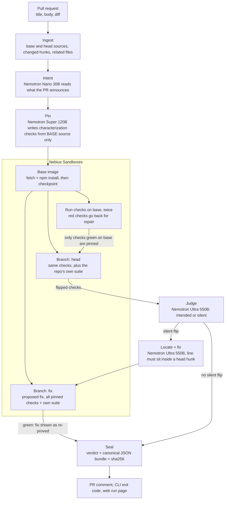
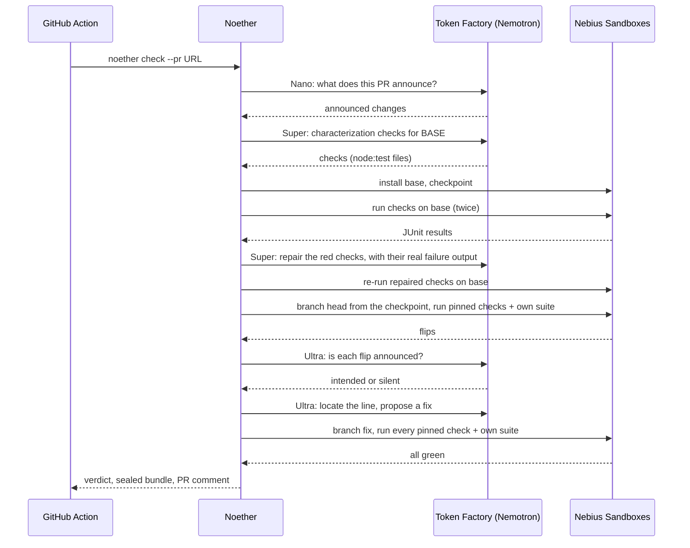

# Noether
### Proof that a pull request changed only what it says


> *"CI is green. The jump is broken."*

[Live pull request with a Noether verdict](https://github.com/omshukla24/hopper/pull/2) · [GitHub Action](action.yml) · [Eval results](evals/results/20261027-123720.md) · [Workflow example](examples/noether.yml)

---

## Executive Summary

A refactor pull request passes its own tests and still changes how the program behaves, in a place the author never mentioned. Review misses it because the diff reads as a cleanup, and CI misses it because no existing test pins that behaviour.

**Noether** catches that kind of change and proves it. It reads what the pull request says it changes, writes characterization checks against the **base** code, keeps only the checks that pass on base, then runs the same checks on the **head** code. Every check that flips is judged as either announced in the pull request (intended) or not (silent). A silent flip gets located to the changed line, and a fix is proposed and shown only after it is re-run green. The result is a sealed proof bundle (canonical JSON + sha256) and a verdict: **CONSERVED**, **BROKEN** or **INCONCLUSIVE**.

The name is Emmy Noether's theorem: every symmetry has a conserved quantity. A safe change conserves the observable behaviour; a silent break is a broken symmetry. In the flagship case it is literal: a refactor of a small 3D platformer (Hopper) lets friction act in mid-air, so horizontal momentum stops being conserved during a jump, and the last gap can no longer be cleared. The repo's own 14 tests pass before and after.

All inference runs on **NVIDIA Nemotron 3** models served by **Nebius Token Factory**, and every check runs in **Nebius Sandboxes** microVMs, with base installed once, checkpointed, and branched for head and for each fix attempt. A verdict is never a model's opinion: it is backed by test runs.

---

## System Architecture & Workflow



| Stage | Model or runtime | Output |
|:---|:---|:---|
| Intent | `nvidia/NVIDIA-Nemotron-3-Nano-30B-A3B` (fallback `nvidia/Nemotron-3_5-Lightning`) | the behaviour changes the pull request announces |
| Pin | `nvidia/nemotron-3-super-120b-a12b` | up to 12 `node:test` checks written from the base source |
| Base, head, fix runs | Nebius Sandboxes, `node:24-slim` image, checkpoint and branch | JUnit results per check, own-suite exit codes |
| Judge | `nvidia/Nemotron-3-Ultra-550b-a55b` | each flip: intended or silent, with a reason |
| Locate and fix | `nvidia/Nemotron-3-Ultra-550b-a55b` | the changed line, and a whole-file fix to re-prove |
| Seal | Python | proof bundle, sha256 verified again in the browser |

---

## End-to-End Sequence



---

## Verdict Rules and Caps

| Verdict | When |
|:---|:---|
| **BROKEN** | at least one silent flip, or the repo's own suite went from exit 0 on base to non-zero on head |
| **CONSERVED** | no silent flip, own suite not worse, at least one check pinned |
| **INCONCLUSIVE** | nothing could be pinned, or the run could not finish; always with a reason |

| Cap (per run, in code) | Value |
|:---|:---|
| Pinned checks | 12 |
| Model tokens | 250,000 |
| Sandbox seconds | 600 |
| Fix attempts | 3 |
| Repair rounds for red base checks | 2, in batches of 4 |
| Public web runs | 3 per address per hour, 30 per day |

A check only counts if it passes on base twice. An unsure or missing judgement counts as silent. A fix is only shown once it turns the broken check green and keeps every other pinned check and the repo's own suite green.

---

## Measured Results

The eval harness in `evals/` runs 14 small repositories, 3 times each, live on Token Factory and Sandboxes. Nine hold a silent break (several modeled on real bugs in camelcase, pretty-ms and slugify, rewritten as original code); five change behaviour exactly as their pull request announces, so any alarm there is a false alarm. Runs are not deterministic, so the harness reports rates.

| Measure | Result |
|:---|:---|
| Silent breaks caught | 12 / 24 = 50 % |
| False alarms on announced-only changes | 1 / 18 = 6 % |
| Inconclusive runs | 2 / 42 (sandbox API timeouts) |
| Estimated model cost, all 42 runs | $0.37 |
| Wall clock | 7 m 16 s, 4 runs in parallel |

| Case | Expected | Result |
|:---|:---|:---|
| uniq-keeps-last | BROKEN | 3 / 3 caught |
| camel-short-numbers | BROKEN | 2 / 3 caught |
| hopper | BROKEN | 2 / 3 caught |
| paginate-past-the-end | BROKEN | 2 / 3 caught |
| tiny-cart | BROKEN | 2 / 3 caught |
| duration-cut-to-round | BROKEN | 1 / 3 caught |
| backoff-jitter-at-cap | BROKEN | 0 / 3 caught |
| slug-acronym-plurals | BROKEN | 0 / 3 caught, 1 inconclusive |
| backoff-cap-announced | CONSERVED | 3 / 3 correct |
| camel-long-numbers-announced | CONSERVED | 3 / 3 correct |
| duration-rounding-announced | CONSERVED | 3 / 3 correct |
| slug-underscore-announced | CONSERVED | 3 / 3 correct |
| cart-threshold-only | CONSERVED | 2 / 3 correct, 1 false alarm |
| uniq-filter-refactor | CONSERVED | 2 / 3 correct, 1 inconclusive |

Full per-run detail: [`evals/results/20261027-123720.md`](evals/results/20261027-123720.md).

On the public Hopper pull request ([omshukla24/hopper#2](https://github.com/omshukla24/hopper/pull/2)) the Action pinned 8 checks on base; 7 held on head and `step-air-control-reduces-acceleration` broke silently. Noether located it at `src/physics.js:109`, proposed a one-line fix and re-proved it green, at an estimated $0.03 of model tokens.

The same loop (checks that pass on the parent and fail on the diff) is described in Meta's *Just-in-Time Catching Test Generation at Meta* (arXiv 2601.22832). Noether is an open version for any repository, with the intent step aimed at the false alarms that paper reports.

---

## Technology Stack

| Layer | Technology | Role |
|:---|:---|:---|
| Models | NVIDIA Nemotron 3 Nano 30B, Super 120B, Ultra 550B | intent, check writing, judging, locating and fixing |
| Inference | Nebius Token Factory (OpenAI-compatible API) | JSON-schema responses, thinking off for intent and pin |
| Execution | Nebius Sandboxes (`contree-sdk` 0.3.6) | microVMs from a Node 24 image; checkpoint after install, branch per head and fix |
| Orchestrator | Python 3.12+, httpx, jsonschema | pipeline, caps, verdict rules, proof bundle |
| API | FastAPI with Server-Sent Events | live runs streamed stage by stage, sealed runs served by id |
| Web | Next.js 16, React 19, three.js 0.186, GSAP 3.15, Lenis | the site, the playable Hopper scene, the `/check` cockpit, run pages |
| CI | GitHub composite Action | runs Noether on a pull request, uploads the bundle, comments, fails the check on BROKEN |
| Tests | pytest, Vitest | 371 Python and 47 TypeScript checks |

---

## API Endpoints

| Endpoint | Method | Response Type | Description |
|:---|:---|:---|:---|
| `/api/health` | `GET` | `application/json` | version, whether live runs are configured, which store is in use |
| `/api/runs` | `POST` | `text/event-stream` | body `{"pr": "https://github.com/owner/repo/pull/N"}`; streams stage events, then the sealed bundle |
| `/api/runs/{run_id}` | `GET` | `application/json` | a sealed proof bundle |

The CLI exits 0 for CONSERVED, 1 for BROKEN and 2 for INCONCLUSIVE.

---

## Local Installation & Quick Start

### 1. Clone the repository
```bash
git clone https://github.com/omshukla24/Noether.git
cd Noether
```

### 2. Create a virtual environment
```bash
python -m venv .venv
```
Activate it with `source .venv/bin/activate` (Linux, macOS) or `.venv\Scripts\activate` (Windows).

### 3. Install
```bash
pip install -e ".[api,dev]"
```

### 4. Add your Nebius keys
Create `.env.local` in the repository root with `NEBIUS_API_KEY`, `NEBIUS_PROJECT_ID` and `NEBIUS_BASE_URL` (`https://api.tokenfactory.nebius.com/v1/`). `GITHUB_TOKEN` is optional (higher GitHub rate limits), and so is `TAVILY_API_KEY` (looks up dependency bumps).

### 5. Check the flagship fixture in Nebius Sandboxes
```bash
python -m noether check --local fixtures/hopper --runner contree --out runs
```

### 6. Check a real pull request
```bash
python -m noether check --pr https://github.com/omshukla24/hopper/pull/2
```

### 7. Run the API and the site
```bash
uvicorn noether.server:app --port 8001
```
```bash
npm --prefix web install
npm --prefix web run dev
```
Set `NEXT_PUBLIC_API_BASE=http://127.0.0.1:8001` for the site to reach the local API, then open `http://localhost:3000`.

### 8. Use it in CI
Copy [`examples/noether.yml`](examples/noether.yml) to `.github/workflows/noether.yml` and add the `NEBIUS_API_KEY` and `NEBIUS_PROJECT_ID` repository secrets.

---

## Reproducible Testing

```bash
python -m pytest
```

```text
============================= test session starts =============================
collected 378 items
tests/test_bundle.py ................                                    [  4%]
tests/test_cli.py ...............                                        [  8%]
tests/test_comment.py ...                                                [  8%]
tests/test_evals.py ...........................................          [ 20%]
tests/test_fix.py ...............                                        [ 24%]
tests/test_ingest.py ........................s                           [ 30%]
tests/test_intent.py ...............                                     [ 34%]
tests/test_judge.py ..........                                           [ 37%]
tests/test_junit.py ..................                                   [ 42%]
tests/test_live.py sssss                                                 [ 43%]
tests/test_nemotron.py ...............................                   [ 51%]
tests/test_pin.py ..................................................     [ 65%]
tests/test_pipeline.py ..................................                [ 74%]
tests/test_runner.py ........................................s           [ 84%]
tests/test_server.py ....................................                [ 94%]
tests/test_verdict.py .....................                              [100%]
================= 371 passed, 7 skipped, 1 warning in 12.15s ==================
```

```bash
npm --prefix web run test
```

```text
 ✓ src/lib/collapse.test.ts (6 tests) 5ms
 ✓ src/lib/story.test.ts (8 tests) 7ms
 ✓ scripts/sync-noether.test.ts (1 test) 216ms
 ✓ src/lib/cockpit.test.ts (11 tests) 8ms
 ✓ src/lib/story-data.test.ts (5 tests) 6ms
 ✓ src/components/Emmy.test.ts (2 tests) 3ms
 ✓ src/lib/runClient.test.ts (5 tests) 13ms
 ✓ src/lib/runs.test.ts (4 tests) 24ms
 ✓ src/hopper/sim.test.ts (5 tests) 196ms
 Test Files  9 passed (9)
      Tests  47 passed (47)
```

Live tests that call Token Factory and Sandboxes are skipped unless `NOETHER_LIVE=1` is set. The evals run with:

```bash
python -m evals.run --runs 3 --runner contree
```

---

## Repository Structure

```text
Noether/
├── action.yml              GitHub composite Action
├── examples/noether.yml    workflow to copy into a repository
├── noether/                orchestrator
│   ├── ingest.py           base and head sources, hunks, pull request text
│   ├── related.py          importers of the changed files, for the pin prompt
│   ├── intent.py           Nano: what the pull request announces
│   ├── pin.py              Super: characterization checks and their repair
│   ├── runner.py           Nebius Sandboxes runner (checkpoint, branch) and a local runner
│   ├── junit.py            JUnit parsing, crash output
│   ├── judge.py            Ultra: intended or silent
│   ├── fix.py              Ultra: locate, fix, re-prove
│   ├── verdict.py          verdict rules
│   ├── bundle.py           proof bundle and sha256 seal
│   ├── comment.py          pull request comment
│   ├── pipeline.py         stages, caps, events
│   ├── nemotron.py         Token Factory client and model routing
│   ├── server.py           FastAPI + SSE
│   └── cli.py              noether check
├── evals/                  14 cases, runner, scorer, results
├── fixtures/               hopper (3D platformer) and tiny-cart
├── tests/                  pytest suite
└── web/                    Next.js site, /check cockpit, run pages, Vercel Python function
```

---

## Notes on Nebius and NVIDIA Tooling

- Nemotron Nano and Super can spend a small `max_tokens` budget entirely on reasoning and return `content: null`; budgets are generous per role and a null answer is treated as a spent budget, not a reply.
- `chat_template_kwargs.enable_thinking=false` turns reasoning off for the intent and pin roles, which cut the pin step from about 200 s to 15 to 25 s.
- Lightning puts its thinking text inside `content`, so it is stripped before JSON is parsed.
- Sandbox images are immutable snapshots: a run returns a new image, which makes checkpoint after install and one branch per head and fix attempt natural.
- The slim Node image has no git, curl or patch, so sources are fetched with Node's `fetch` and fixes are applied as whole files.
- The sandbox API occasionally times out on a single call; one retry is enough.

---

## License & Author

* **Author**: Om Shukla
* **Project**: Noether
* **Contest**: Nebius x NVIDIA Global AI Hackathon, Coding & Agentic Engineering track
* **License**: MIT License
