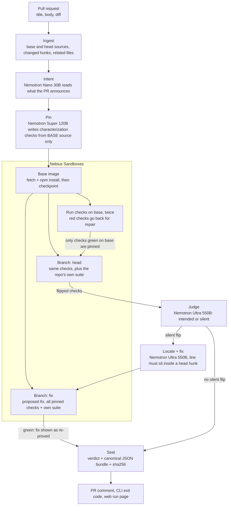
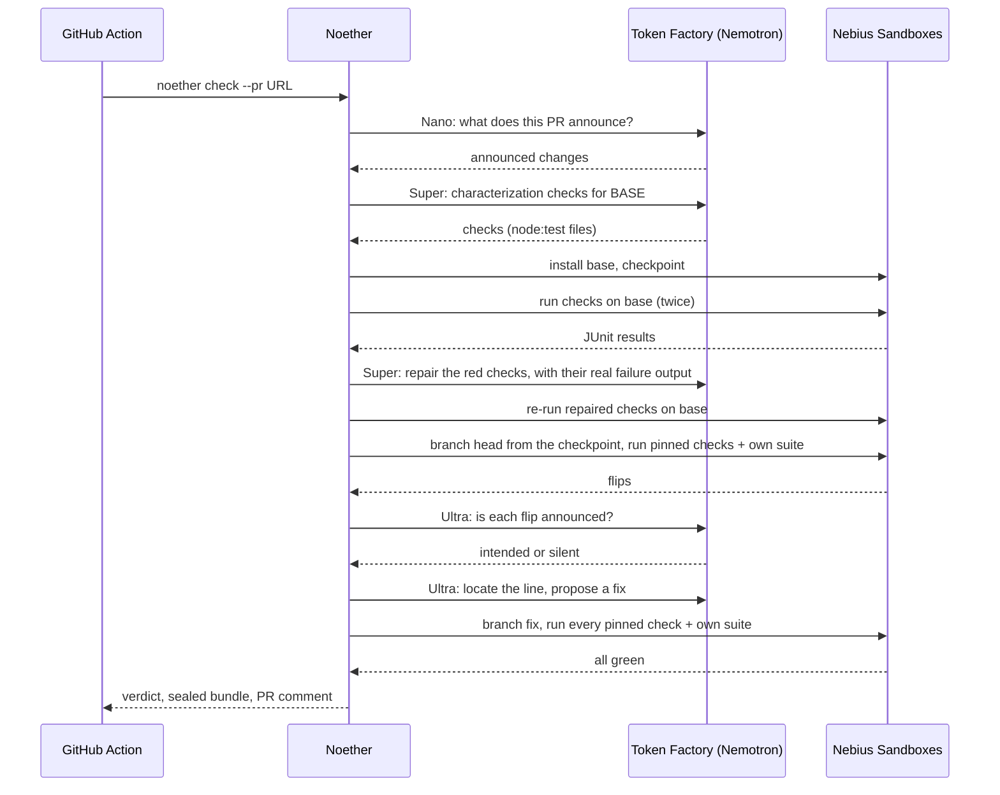

# Noether
### Proof that a pull request changed only what it says


> *"CI is green. The jump is broken."*

[Live site](https://noether.34-202-39-186.sslip.io) · [Live pull request with a Noether verdict](https://github.com/omshukla24/hopper/pull/2) · [GitHub Action](action.yml) · [Eval results](evals/results/20261030-134637.md) · [Workflow example](examples/noether.yml)

---

## Executive Summary

A refactor pull request passes its own tests and still changes how the program behaves, in a place the author never mentioned. Review misses it because the diff reads as a cleanup, and CI misses it because no existing test pins that behaviour.

**Noether** catches that kind of change and proves it. It reads what the pull request says it changes, writes characterization checks against the **base** code, keeps only the checks that pass on base, then runs the same checks on the **head** code; when nothing flips, a second round of checks aimed at the changed lines runs the same way. Every check that flips is judged as either announced in the pull request (intended) or not (silent). A silent flip gets located to the changed line, and a fix is proposed and shown only after it is re-run green. The result is a sealed proof bundle (canonical JSON + sha256) and a verdict: **CONSERVED**, **BROKEN** or **INCONCLUSIVE**.

The name is Emmy Noether's theorem: every symmetry has a conserved quantity. A safe change conserves the observable behaviour; a silent break is a broken symmetry. In the flagship case it is literal: a refactor of a small 3D platformer (Hopper) lets friction act in mid-air, so horizontal momentum stops being conserved during a jump, and the last gap can no longer be cleared. The repo's own 14 tests pass before and after.

All inference runs on **NVIDIA Nemotron 3** models served by **Nebius Token Factory**, and every check runs in **Nebius Sandboxes** microVMs, with base installed once, checkpointed, and branched for head and for each fix attempt. A verdict is never a model's opinion: it is backed by test runs.

---

## System Architecture & Workflow



| Stage | Model or runtime | Output |
|:---|:---|:---|
| Intent | `nvidia/NVIDIA-Nemotron-3-Nano-30B-A3B` (fallback `nvidia/Nemotron-3_5-Lightning`) | the behaviour changes the pull request announces, read from its title and text, not the diff |
| Pin | `nvidia/nemotron-3-super-120b-a12b` | up to 12 `node:test` checks written from the base source |
| Probe | `nvidia/nemotron-3-super-120b-a12b` | up to 6 more checks aimed at the changed lines, written only when the first round finds no silent flip; each still has to pass twice on base |
| Base, head, fix runs | Nebius Sandboxes, `node:24-slim` image, checkpoint and branch | JUnit results per check, own-suite exit codes |
| Judge | `nvidia/Nemotron-3-Ultra-550b-a55b` | each flip: what the announced rule gives, what head gives, then intended or silent, with a reason |
| Locate and fix | `nvidia/Nemotron-3-Ultra-550b-a55b` | the changed line, and a whole-file fix to re-prove |
| Seal | Python | proof bundle, sha256 verified again in the browser |

---

## End-to-End Sequence



---

## Verdict Rules and Caps

| Verdict | When |
|:---|:---|
| **BROKEN** | at least one silent flip, or the repo's own suite went from exit 0 on base to non-zero on head |
| **CONSERVED** | no silent flip, own suite not worse, at least one check pinned |
| **INCONCLUSIVE** | nothing could be pinned, or the run could not finish; always with a reason |

| Cap (per run, in code) | Value |
|:---|:---|
| Pinned checks, first round | 12 |
| Pinned checks, probe round | 6 |
| Model tokens | 250,000 |
| Sandbox seconds | 600 |
| Fix attempts | 3 |
| Repair rounds for red base checks | 2, in batches of 4 |

| Limit on the hosted site | Value |
|:---|:---|
| Live runs per address | 3 per hour |
| Live runs in total | 10 per day |
| One live run | stopped at 270 s; the pipeline aborts itself at 255 s |

The two counts are the settings `NOETHER_RUNS_PER_IP_HOUR` and `NOETHER_RUNS_PER_DAY` (the code defaults are 3 and 30); `deploy/aws/provision.py --env` sets them to 3 and 10.

A check only counts if it passes on base twice. An unsure or missing judgement counts as silent. A fix is only shown once it turns the broken check green and keeps every other pinned check and the repo's own suite green.

---

## Measured Results

The eval harness in `evals/` runs 14 small repositories, 3 times each, live on Token Factory and Sandboxes. Eight hold a silent break (several modeled on real bugs in camelcase, pretty-ms and slugify, rewritten as original code); six change behaviour exactly as their pull request announces, so any alarm there is a false alarm. Runs are not deterministic, so the harness reports rates. These are the newest results.

| Measure | Result |
|:---|:---|
| Silent breaks caught | 19 / 24 = 79 % |
| False alarms on announced-only changes | 0 / 18 = 0 % |
| Inconclusive runs | 0 / 42 |
| Hits found only by the diff-guided probe round | 6 of 19 |
| Estimated model cost, all 42 runs | $0.86 |
| Wall clock | 14 m 06 s, 3 runs in parallel |

| Case | Expected | Result |
|:---|:---|:---|
| uniq-keeps-last | BROKEN | 3 / 3 caught |
| camel-short-numbers | BROKEN | 3 / 3 caught |
| backoff-jitter-at-cap | BROKEN | 3 / 3 caught |
| duration-cut-to-round | BROKEN | 3 / 3 caught |
| paginate-past-the-end | BROKEN | 3 / 3 caught |
| slug-acronym-plurals | BROKEN | 2 / 3 caught |
| hopper | BROKEN | 1 / 3 caught |
| tiny-cart | BROKEN | 1 / 3 caught |
| backoff-cap-announced | CONSERVED | 3 / 3 correct |
| camel-long-numbers-announced | CONSERVED | 3 / 3 correct |
| cart-threshold-only | CONSERVED | 3 / 3 correct |
| duration-rounding-announced | CONSERVED | 3 / 3 correct |
| slug-underscore-announced | CONSERVED | 3 / 3 correct |
| uniq-filter-refactor | CONSERVED | 3 / 3 correct |

Full per-run detail: [`evals/results/20261030-134637.md`](evals/results/20261030-134637.md).

The same 14 cases after each change to the pipeline:

| Round | What changed | Caught | False alarms |
|:---|:---|:---|:---|
| 27 Oct | first measured round, before the probe round | 12 / 24 = 50 % | 1 / 18 = 6 % |
| A | the diff-guided probe round added | 20 / 24 = 83 % | 3 / 18 = 17 % |
| B | intent stops reading the diff; the judge reads an announced rule as covering every input it names | 17 / 24 = 71 % | 2 / 18 = 11 % |
| C | the judge writes what the rule gives and what head gives before it labels a flip | 19 / 24 = 79 % | 2 / 18 = 11 % |
| D | the judge is told that examples show a rule and never narrow it; one fixture that really changed behaviour on sparse arrays is corrected | 19 / 24 = 79 % | 0 / 18 = 0 % |

Weak spots in the newest round: Hopper was caught in 1 of 3 runs, tiny-cart in 1 of 3 and slug-acronym-plurals in 2 of 3. In every miss each pinned check either still held on head or changed as the pull request announced, so no check covered the break. The two missed Hopper runs pinned only 4 and 3 checks (13 and 4 others were dropped on base). A fresh run of the Hopper pull request can therefore say CONSERVED, although the sealed run below caught the break.

On the public Hopper pull request ([omshukla24/hopper#2](https://github.com/omshukla24/hopper/pull/2)) the Action pinned 8 checks on base; 7 held on head and `step-air-control-reduces-acceleration` broke silently. Noether located it at `src/physics.js:109`, proposed a one-line fix and re-proved it green, at an estimated $0.03 of model tokens.

The same loop (checks that pass on the parent and fail on the diff) is described in Meta's *Just-in-Time Catching Test Generation at Meta* (arXiv 2601.22832). Noether is an open version for any repository, with the intent step aimed at the false alarms that paper reports.

---

## Technology Stack

| Layer | Technology | Role |
|:---|:---|:---|
| Models | NVIDIA Nemotron 3 Nano 30B, Super 120B, Ultra 550B | intent, check writing, judging, locating and fixing |
| Inference | Nebius Token Factory (OpenAI-compatible API) | JSON-schema responses, thinking off for intent and pin |
| Execution | Nebius Sandboxes (`contree-sdk` 0.3.6) | microVMs from a Node 24 image; checkpoint after install, branch per head and fix |
| Orchestrator | Python 3.12+, httpx, jsonschema | pipeline, caps, verdict rules, proof bundle |
| API | FastAPI with Server-Sent Events | live runs streamed stage by stage, sealed runs served by id |
| Web | Next.js 16, React 19, three.js 0.186, GSAP 3.15, Lenis | the site, the playable Hopper scene, the `/check` cockpit, run pages |
| CI | GitHub composite Action | runs Noether on a pull request, uploads the bundle, comments, fails the check on BROKEN |
| Hosting | AWS EC2 (t3.small), Caddy, systemd | one instance in us-east-1; Caddy serves HTTPS under sslip.io and proxies the site (port 3000) and the API (port 3001); the settings live in an SSM SecureString |
| Tests | pytest, Vitest | 385 Python and 62 TypeScript checks |

---

## API Endpoints

| Endpoint | Method | Response Type | Description |
|:---|:---|:---|:---|
| `/api/health` | `GET` | `application/json` | version, whether live runs are configured, which store is in use |
| `/api/runs` | `POST` | `text/event-stream` | body `{"pr": "https://github.com/owner/repo/pull/N"}`; streams stage events, then the sealed bundle |
| `/api/runs/{run_id}` | `GET` | `application/json` | a sealed proof bundle |

The CLI exits 0 for CONSERVED, 1 for BROKEN and 2 for INCONCLUSIVE.

---

## Local Installation & Quick Start

### 1. Clone the repository
```bash
git clone https://github.com/omshukla24/Noether.git
cd Noether
```

### 2. Create a virtual environment
```bash
python -m venv .venv
```
Activate it with `source .venv/bin/activate` (Linux, macOS) or `.venv\Scripts\activate` (Windows).

### 3. Install
```bash
pip install -e ".[api,dev]"
```

### 4. Add your Nebius keys
Create `.env.local` in the repository root with `NEBIUS_API_KEY`, `NEBIUS_PROJECT_ID` and `NEBIUS_BASE_URL` (`https://api.tokenfactory.nebius.com/v1/`). `GITHUB_TOKEN` is optional (higher GitHub rate limits), and so is `TAVILY_API_KEY` (looks up dependency bumps).

### 5. Check the flagship fixture in Nebius Sandboxes
```bash
python -m noether check --local fixtures/hopper --runner contree --out runs
```

### 6. Check a real pull request
```bash
python -m noether check --pr https://github.com/omshukla24/hopper/pull/2
```

### 7. Run the API and the site
```bash
uvicorn noether.server:app --port 8001
```
```bash
npm --prefix web install
npm --prefix web run dev
```
Set `NEXT_PUBLIC_API_BASE=http://127.0.0.1:8001` for the site to reach the local API, then open `http://localhost:3000`.

### 8. Use it in CI
Copy [`examples/noether.yml`](examples/noether.yml) to `.github/workflows/noether.yml` and add the `NEBIUS_API_KEY` and `NEBIUS_PROJECT_ID` repository secrets.

---

## Deploy on AWS

One EC2 instance (t3.small, us-east-1) with a fixed address. Caddy serves HTTPS under `<address>.sslip.io`, so no domain has to be bought first. The script and the instance setup are in [`deploy/aws/`](deploy/aws/). It needs the AWS CLI signed in to the account, and the `.env.local` from step 4 above.

### 1. Create the role, firewall and address
```bash
python deploy/aws/provision.py --infra
```

### 2. Store the settings the server needs
```bash
python deploy/aws/provision.py --env
```
This reads `NEBIUS_API_KEY`, `NEBIUS_PROJECT_ID` and `NEBIUS_BASE_URL` from `.env.local` into the SSM parameter `/noether/env` and never prints them. It is safe to re-run.

### 3. Start the instance, which builds `main`
```bash
python deploy/aws/provision.py
```

### 4. Ship `main` again later
```bash
python deploy/aws/provision.py --update
```

---

## Reproducible Testing

```bash
python -m pytest
```

```text
============================= test session starts =============================
collected 392 items
tests\test_bundle.py ................                                    [  4%]
tests\test_cli.py ...............                                        [  7%]
tests\test_comment.py ...                                                [  8%]
tests\test_evals.py ............................................         [ 19%]
tests\test_fix.py ...............                                        [ 23%]
tests\test_ingest.py ........................s                           [ 30%]
tests\test_intent.py ...............                                     [ 33%]
tests\test_judge.py ............                                         [ 36%]
tests\test_junit.py ..................                                   [ 41%]
tests\test_live.py sssss                                                 [ 42%]
tests\test_nemotron.py ...............................                   [ 50%]
tests\test_pin.py ...................................................... [ 64%]
.                                                                        [ 64%]
tests\test_pipeline.py ........................................          [ 75%]
tests\test_runner.py ........................................s           [ 85%]
tests\test_server.py ....................................                [ 94%]
tests\test_verdict.py .....................                              [100%]
================= 385 passed, 7 skipped, 1 warning in 13.16s ==================
```

```bash
npm --prefix web run test
```

```text
 ✓ src/lib/action.test.ts (6 tests) 12ms
 ✓ src/scenes/hopper/porcelain.test.ts (3 tests) 6ms
 ✓ src/lib/cockpit.test.ts (11 tests) 12ms
 ✓ scripts/sync-noether.test.ts (1 test) 105ms
 ✓ src/lib/runClient.test.ts (5 tests) 20ms
 ✓ src/lib/story.test.ts (8 tests) 9ms
 ✓ src/lib/collapse.test.ts (6 tests) 8ms
 ✓ src/lib/runs.test.ts (4 tests) 18ms
 ✓ src/lib/evals.test.ts (3 tests) 73ms
 ✓ src/lib/story-data.test.ts (5 tests) 7ms
 ✓ src/components/Emmy.test.ts (2 tests) 4ms
 ✓ src/lib/comment.test.ts (3 tests) 266ms
 ✓ src/hopper/sim.test.ts (5 tests) 167ms
 Test Files  13 passed (13)
      Tests  62 passed (62)
```

Live tests that call Token Factory and Sandboxes are skipped unless `NOETHER_LIVE=1` is set. The evals run with:

```bash
python -m evals.run --runs 3 --runner contree
```

---

## Repository Structure

```text
Noether/
├── action.yml              GitHub composite Action
├── examples/noether.yml    workflow to copy into a repository
├── noether/                orchestrator
│   ├── ingest.py           base and head sources, hunks, pull request text
│   ├── related.py          importers of the changed files, for the pin prompt
│   ├── intent.py           Nano: what the pull request announces (title and text only)
│   ├── pin.py              Super: characterization checks, their repair and the diff-guided probe round
│   ├── runner.py           Nebius Sandboxes runner (checkpoint, branch) and a local runner
│   ├── junit.py            JUnit parsing, crash output
│   ├── judge.py            Ultra: intended or silent
│   ├── fix.py              Ultra: locate, fix, re-prove
│   ├── verdict.py          verdict rules
│   ├── bundle.py           proof bundle and sha256 seal
│   ├── comment.py          pull request comment
│   ├── pipeline.py         stages, caps, events
│   ├── nemotron.py         Token Factory client and model routing
│   ├── server.py           FastAPI + SSE
│   └── cli.py              noether check
├── deploy/aws/             provision.py (AWS CLI), bootstrap.sh, Caddyfile, three systemd units
├── evals/                  14 cases, runner, scorer, results
├── fixtures/               hopper (3D platformer) and tiny-cart
├── tests/                  pytest suite
└── web/                    Next.js site, /check cockpit, run pages (api/index.py and vercel.json: an alternative entry)
```

---

## Notes on Nebius and NVIDIA Tooling

- Nemotron Nano and Super can spend a small `max_tokens` budget entirely on reasoning and return `content: null`; budgets are generous per role and a null answer is treated as a spent budget, not a reply.
- `chat_template_kwargs.enable_thinking=false` turns reasoning off for the intent and pin roles, which cut the pin step from about 200 s to 15 to 25 s.
- Lightning puts its thinking text inside `content`, so it is stripped before JSON is parsed.
- Sandbox images are immutable snapshots: a run returns a new image, which makes checkpoint after install and one branch per head and fix attempt natural.
- The slim Node image has no git, curl or patch, so sources are fetched with Node's `fetch` and fixes are applied as whole files.
- The sandbox API occasionally times out on a single call; one retry is enough.

---

## License & Author

* **Author**: Om Shukla
* **Project**: Noether
* **Contest**: Nebius x NVIDIA Global AI Hackathon, Coding & Agentic Engineering track
* **License**: MIT License
